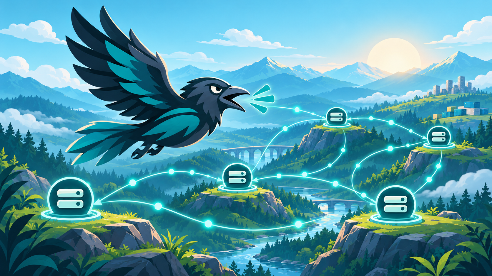

# CrowCast

[](https://github.com/mape1402/crowcast/actions/workflows/build-and-release.yml)
[](https://www.nuget.org/packages/CrowCast)
[](https://www.nuget.org/packages/CrowCast)




CrowCast is an application-neutral gossip library for replicas of the same .NET service.

It gives an application eventual cluster membership, failure observations, message dissemination, local deduplication, coordinator notifications, metrics, and diagnostics without requiring a database or broker.

CrowCast is designed for dynamic environments such as Kubernetes: every process receives a random runtime identity, replicas can come and go, and discovery remains independent from the core protocol.

## What CrowCast Is — And Is Not

Use CrowCast for lightweight cluster signals such as:

- replica presence and availability;
- cache or configuration invalidation;
- topology and partition notifications;
- small application-defined events;
- advisory coordinator selection;
- reacting when a replica joins, becomes suspect, leaves, or disappears.

CrowCast is not:

- a durable queue or event store;
- a database or broker;
- an exactly-once delivery system;
- a distributed lock or lease;
- an application job executor;
- a replacement for consumer-owned consistency and idempotency.

Delivery is eventual. Consumers must tolerate retries, duplicate delivery outside the local deduplication window, and different observation order on different replicas.

## Packages

```bash
dotnet add package CrowCast
dotnet add package CrowCast.Akka
```

- `CrowCast` contains the public API, membership and messaging models, discovery and backend abstractions, event dispatch, deduplication, coordination, metrics, and diagnostics. It has no Akka dependency.
- `CrowCast.Akka` provides the Akka.NET Cluster and Distributed PubSub backend.

Applications normally reference both packages while Akka is the selected backend. A different transport can implement `ICrowCastBackend` without changing consumer code.

## Getting Started

### 1. Create an event handler

CrowCast delivers membership, message, and coordinator changes through `ICrowCastEventHandler`:

```csharp
using System.Text;
using CrowCast.Events;
using Microsoft.Extensions.Logging;

public sealed class ApplicationCrowCastHandler(
    ILogger<ApplicationCrowCastHandler> logger) : ICrowCastEventHandler
{
    public ValueTask HandleAsync(
        CrowCastEvent @event,
        CancellationToken cancellationToken)
    {
        switch (@event)
        {
            case CrowCastMemberChanged member:
                logger.LogInformation(
                    "CrowCast member {Identity}: {Previous} -> {Current}",
                    member.Current.Identity,
                    member.Previous?.Status.ToString() ?? "new",
                    member.Current.Status);
                break;

            case CrowCastMessageReceived received:
                logger.LogInformation(
                    "CrowCast message {Type} from {Origin}: {Content}",
                    received.Message.Type,
                    received.Message.Origin,
                    Encoding.UTF8.GetString(received.Message.Content.Span));
                break;

            case CrowCastCoordinatorChanged coordinator:
                logger.LogInformation(
                    "CrowCast coordinator changed from {Previous} to {Current}",
                    coordinator.Previous,
                    coordinator.Current);
                break;
        }

        return ValueTask.CompletedTask;
    }
}
```

Handlers decide what an event means to the application. CrowCast never executes business work on their behalf.

### 2. Register a local cluster

The first local replica can use its own endpoint as the seed. Other replicas use the same seed endpoint with a different local port:

```csharp
using CrowCast.Akka.DependencyInjection;
using CrowCast.Backends;
using CrowCast.DependencyInjection;
using Microsoft.Extensions.Hosting;

var builder = Host.CreateApplicationBuilder(args);

var crowCast = builder.Services.AddCrowCast(options =>
{
    options.ClusterName = "orders-api";
    options.ExchangeInterval = TimeSpan.FromSeconds(1);
    options.SuspectAfter = TimeSpan.FromSeconds(10);
    options.DeadAfter = TimeSpan.FromSeconds(30);
    options.DeduplicationWindow = TimeSpan.FromMinutes(5);
    options.MessageTimeToLive = TimeSpan.FromMinutes(5);
    options.Metadata["service"] = "orders-api";
});

crowCast.UseAkka(options =>
{
    options.HostName = "127.0.0.1";
    options.Port = 4053;
});

crowCast.UseStaticNodeDiscovery(
    new CrowCastEndpoint("127.0.0.1", 4053));

crowCast.AddEventHandler<ApplicationCrowCastHandler>();

await builder.Build().RunAsync();
```

`AddCrowCast` registers the hosted lifecycle automatically. Application startup completes after the local Akka member is `Up` and its pub/sub subscription is ready.

### 3. Publish a message

CrowCast messages contain a globally unique ID, an application-defined type, opaque bytes, optional metadata, and an optional origin:

```csharp
using System.Text.Json;
using CrowCast;
using CrowCast.Messaging;

public sealed class PartitionPublisher(ICrowCast crowCast)
{
    public ValueTask PublishAsync(
        PartitionChanged payload,
        CancellationToken cancellationToken)
    {
        var message = CrowCastMessage.Create(
            "partition.changed.v1",
            JsonSerializer.SerializeToUtf8Bytes(payload),
            new Dictionary<string, string>
            {
                ["schema"] = "v1"
            });

        return crowCast.PublishAsync(message, cancellationToken);
    }
}
```

When `Origin` is absent, CrowCast attaches the local runtime identity before publishing. The origin is contextual information only; it does not grant ownership or authority over the message or related work.

### 4. Run two replicas

The included sample accepts a local port and seed endpoint:

```powershell
dotnet run --project samples/CrowCast.Sample -- --port 4053 --seed-port 4053
dotnet run --project samples/CrowCast.Sample -- --port 4054 --seed-port 4053
```

Both processes generate independent identities, converge on the same membership, exchange sample messages, and report the same advisory coordinator.

## How It Works

1. The core creates a random node identity and generation for the current process.
2. The selected discovery implementation returns one or more contact endpoints.
3. The Akka backend joins an existing cluster or bootstraps itself when no contacts exist.
4. Every replica periodically announces its CrowCast identity, endpoint, start time, and metadata.
5. Akka membership and reachability observations become CrowCast membership changes.
6. Messages are disseminated through Distributed PubSub and deduplicated locally by message ID.
7. Every replica independently derives the same coordinator when it observes the same set of live members.

The public API does not expose Akka types. Applications interact with `ICrowCast`, `ICrowCastEventHandler`, and the CrowCast models.

## Replica Identity

Every process receives a random `CrowCastNodeId` and a random `CrowCastNodeGeneration` at runtime. Applications do not configure fixed replica names.

The shared `ClusterName` identifies the logical service cluster. It is not an individual replica identity.

A restarted pod receives a new identity and generation even if Kubernetes later reuses the same IP address. CrowCast can therefore distinguish a new process from delayed information about a previous process at the same endpoint.

## Membership

CrowCast exposes four states:

| Status | Meaning |
| --- | --- |
| `Alive` | The member participates in the cluster and is reachable. |
| `Suspect` | The failure detector currently observes the member as unreachable. |
| `Dead` | The member was downed or removed without an orderly CrowCast departure. |
| `Left` | The member announced an orderly departure. |

`Suspect` is not immediately treated as `Dead`. `SuspectAfter` allows normal network variation, and `DeadAfter` includes the subsequent stable period before the split-brain resolver removes a member.

A later valid announcement can refute `Suspect`. `Dead` and `Left` are terminal for the same node generation.

When Akka removes a member, the backend releases its endpoint and announcement state immediately. The core retains only the newest terminal members, bounded by `MaximumRetainedTerminalMembers`. Set it to `0` when the application needs events but no terminal history in `ICrowCast.Members`.

Read the current local view at any time:

```csharp
var aliveMembers = crowCast.Members
    .Where(member => member.Status == CrowCastMemberStatus.Alive)
    .ToArray();
```

Membership is an eventually consistent local view. Different replicas can temporarily observe different states during network delays or partitions.

## Messaging And Deduplication

CrowCast is intended for compact notifications, not bulk payload transfer.

- IDs are generated by `CrowCastMessageId.New()` through `CrowCastMessage.Create(...)`.
- Types are application-owned strings. Version them when payload shape changes.
- Content is opaque `ReadOnlyMemory<byte>`.
- Metadata is a small string dictionary for schema, tracing, or routing context.
- Deduplication is local, in memory, bounded, and valid only for the configured window.
- Messages older than `MessageTimeToLive` are rejected.
- Messages too far in the future are rejected using `MaximumClockSkew`.
- Receive rate limiting protects each replica from unbounded inbound bursts.

The default application payload limit is 64 KiB. The default Akka frame limit is 256 KiB, allowing room for the message envelope and metadata. If application limits increase, `MaximumFrameSizeBytes` must remain large enough for the complete wire frame.

CrowCast is not durable. A message published while no subscriber is reachable can be lost, and a process restart clears local deduplication state.

## Coordinator

When coordinator election is enabled, each replica selects the lowest `(NodeId, Generation)` pair among the members it currently observes as `Alive`.

```csharp
if (crowCast.Coordinator == crowCast.LocalNode)
{
    // This replica is the current advisory coordinator in its local view.
}
```

Coordinator selection is a convenience for advisory cluster coordination. It is not a distributed lock, a durable lease, or strong consensus. During a partition, two groups can temporarily select different coordinators. Consumer operations must remain idempotent and safe to retry.

Disable coordinator calculation when it is not needed:

```csharp
options.EnableCoordinatorElection = false;
```

## Discovery

Discovery is defined by `ICrowCastNodeDiscovery` and remains independent from the gossip backend.

### Static discovery

Use static discovery for local development, integration tests, and environments with a stable contact endpoint:

```csharp
crowCast.UseStaticNodeDiscovery(
    new CrowCastEndpoint("127.0.0.1", 4053));
```

### DNS discovery

Use DNS discovery for a stable service name whose addresses represent the current replicas:

```csharp
crowCast.UseDnsNodeDiscovery("orders-api-crowcast", 4053);
```

DNS resolution happens during startup. Existing cluster members maintain membership through Akka; a new replica only needs one reachable discovered member to join.

Applications can provide another implementation of `ICrowCastNodeDiscovery` for platform-specific discovery without changing CrowCast itself.

## Kubernetes

CrowCast does not require Kubernetes, but DNS discovery is designed to work cleanly with ephemeral pods and HPA.

Create a headless Service with `publishNotReadyAddresses: true` so the first pod can discover its own address before application readiness completes:

```yaml
apiVersion: v1
kind: Service
metadata:
  name: orders-api-crowcast
spec:
  clusterIP: None
  publishNotReadyAddresses: true
  selector:
    app.kubernetes.io/name: orders-api
  ports:
    - name: crowcast
      protocol: TCP
      port: 4053
      targetPort: 4053
```

Inject the pod IP through the downward API and expose the CrowCast port only inside the cluster:

```yaml
spec:
  terminationGracePeriodSeconds: 30
  containers:
    - name: orders-api
      env:
        - name: POD_IP
          valueFrom:
            fieldRef:
              fieldPath: status.podIP
      ports:
        - name: crowcast
          containerPort: 4053
```

Configure every replica with the same service name while advertising its own pod IP:

```csharp
var podIp = Environment.GetEnvironmentVariable("POD_IP")
    ?? throw new InvalidOperationException("POD_IP is required.");

var crowCast = builder.Services.AddCrowCast(options =>
{
    options.ClusterName = "orders-api";
    options.Metadata["service"] = "orders-api";
});

crowCast.UseAkka(options =>
{
    options.HostName = "0.0.0.0";
    options.Port = 4053;
    options.PublicHostName = podIp;
    options.PublicPort = 4053;
});

crowCast.UseDnsNodeDiscovery("orders-api-crowcast", 4053);
crowCast.AddEventHandler<ApplicationCrowCastHandler>();
```

The repository contains adaptable templates for the [`Headless Service`](deploy/kubernetes/headless-service.yaml) and a same-workload [`NetworkPolicy`](deploy/kubernetes/network-policy.yaml).

## Configuration

### Core options

| Option | Default | Purpose |
| --- | --- | --- |
| `ClusterName` | `crowcast` | Shared namespace for replicas of the same service. |
| `ExchangeInterval` | `1 second` | Membership and gossip exchange cadence. |
| `SuspectAfter` | `10 seconds` | Acceptable heartbeat pause before a member becomes suspect. |
| `DeadAfter` | `30 seconds` | Total failure window before removal can stabilize. |
| `DeduplicationWindow` | `5 minutes` | Local message-ID retention window. |
| `MessageTimeToLive` | `5 minutes` | Maximum accepted message age. |
| `MaximumDeduplicationEntries` | `100,000` | Maximum local message IDs retained. |
| `MaximumRetainedTerminalMembers` | `1,024` | Maximum recent `Dead` and `Left` members retained. |
| `MaximumMessageContentBytes` | `64 KiB` | Maximum opaque application payload. |
| `MaximumMetadataEntries` | `32` | Maximum metadata pairs per message or member. |
| `MaximumClockSkew` | `30 seconds` | Allowed future timestamp skew. |
| `MaximumReceivedMessagesPerInterval` | `10,000` | Per-replica inbound message burst limit. |
| `ReceivedMessageRateLimitInterval` | `1 second` | Window used by the inbound rate limiter. |
| `EnableCoordinatorElection` | `true` | Enables deterministic advisory coordinator selection. |

Additional limits are available for message types, metadata keys and values, and endpoint lengths.

### Akka options

| Option | Default | Purpose |
| --- | --- | --- |
| `HostName` | `127.0.0.1` | Local bind hostname or address. |
| `Port` | `0` | Local bind port; `0` selects a dynamic port. |
| `PublicHostName` | unset | Address advertised to other replicas. |
| `PublicPort` | unset | Port advertised to other replicas. |
| `StartupTimeout` | `15 seconds` | Maximum wait for membership and pub/sub readiness. |
| `ShutdownTimeout` | `15 seconds` | Maximum graceful shutdown wait. |
| `MaximumFrameSizeBytes` | `256 KiB` | Maximum Akka remote frame size. |
| `AdditionalConfiguration` | unset | Advanced HOCON overrides applied over CrowCast defaults. |

Treat `AdditionalConfiguration` as security-sensitive application configuration.

## Diagnostics And Metrics

Resolve `ICrowCastDiagnostics` to obtain an in-process snapshot:

```csharp
var diagnostics = serviceProvider.GetRequiredService<ICrowCastDiagnostics>();
var snapshot = diagnostics.GetSnapshot();

logger.LogInformation(
    "CrowCast has {Alive} alive members and observed {Duplicates} duplicates",
    snapshot.AliveMembers,
    snapshot.DuplicateMessages);
```

CrowCast publishes metrics through the `Elysium.CrowCast` `System.Diagnostics.Metrics` meter:

- `crowcast.members`, tagged by status;
- `crowcast.messages.published`;
- `crowcast.messages.received`;
- `crowcast.messages.duplicates`;
- `crowcast.messages.expired`;
- `crowcast.messages.rejected`, tagged by reason;
- `crowcast.membership.rejected`, tagged by reason;
- `crowcast.membership.changes`;
- `crowcast.coordinator.changes`.

CrowCast uses `Microsoft.Extensions.Logging` but does not select a logging or metrics exporter.

## Input Protection

CrowCast validates locally published and remotely received data. The Akka backend:

- uses a dedicated versioned serializer for CrowCast wire contracts;
- disables fallback serialization for unregistered types;
- rejects unknown JSON fields;
- limits remote frame size;
- validates message, metadata, endpoint, and timestamp bounds;
- bounds deduplication and terminal membership state;
- samples repetitive rejection logs.

These controls protect parser and process resources. They do not authenticate another replica.

## Security

Transport authentication and encryption are intentionally outside the core library in the current phase.

Keep the CrowCast port inside a trusted network boundary. In Kubernetes, apply a `NetworkPolicy` that permits the gossip port only between replicas of the same workload. Network policies are additive, so review other policies that might permit broader ingress.

If the platform already provides workload mTLS through a service mesh or CNI, CrowCast can use that protected transport without managing certificates itself.

## Extensibility

The core is independent from Akka, Kubernetes, brokers, databases, and application business models.

- Implement `ICrowCastBackend` to replace Akka.
- Implement `ICrowCastNodeDiscovery` to integrate another discovery mechanism.
- Register one or more `ICrowCastEventHandler` implementations for application reactions.
- Use `AdditionalConfiguration` for advanced Akka behavior that does not belong in the core API.

See the [architecture guide](docs/architecture.md) for protocol boundaries, delivery semantics, and extension points.

## Sample

Run one local replica:

```powershell
dotnet run --project samples/CrowCast.Sample -- --port 4053 --seed-port 4053
```

Run additional replicas by changing only the local port:

```powershell
dotnet run --project samples/CrowCast.Sample -- --port 4054 --seed-port 4053
dotnet run --project samples/CrowCast.Sample -- --port 4055 --seed-port 4053
```

To exercise DNS discovery, pass `--seed-service <dns-name>` to every replica.

## Build From Source

```powershell
dotnet restore CrowCast.sln
dotnet build CrowCast.sln --configuration Release
dotnet test CrowCast.sln --configuration Release
```

The library targets .NET 8, .NET 9, and .NET 10. The test suite maintains 100% line and branch coverage for the current production assemblies.

## License

CrowCast is licensed under the [MIT License](LICENSE).
